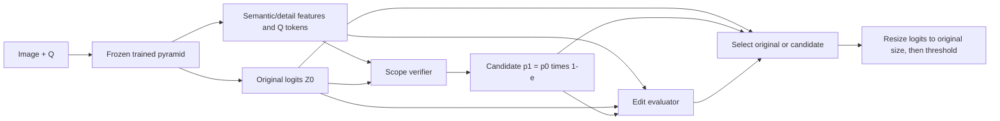

# Question-guided scope correction

This experiment adds a **79,803-parameter** scope verifier and edit evaluator to
a trained `exp/question-guided-detail-pyramid` checkpoint. The complete parent
predictor stays frozen, including its CNN, decoder, FiLM, encoders and refiner.
There is one shared CLIP image/text pass. Inputs are image + question in both
training and inference; no answer or extra annotation is required.

The verifier predicts removal probability `e`. The candidate is
`p1 = sigmoid(Z0) * (1-e)`, evaluated through stable logits without probability
clamping. It can remove interior false positives anywhere, but cannot recover
missing foreground. The evaluator estimates whole-mask IoU gain and the fraction
of the parent's true positives destroyed. It compares retained/removed features,
question features, and spatial mask descriptors. Its inputs are detached from the
verifier. Selection returns the original logits **exactly** unless both checks pass.
An incorrect selection can still hurt accuracy; preservation is an experimental
question, not a guarantee.



## Setup and train

Use Python 3.12+ and the repository's locked environment:

```bash
uv sync --frozen
uv run --frozen torchrun --standalone --nproc_per_node=2 preflight.py \
    --data-root /path/to/vizwiz \
    --init-parent-checkpoint /path/to/pyramid/checkpoint_epoch20.pt \
    --batch-size 4 --num-workers 0 --steps 3 --lr 0.0001

uv run --frozen torchrun --standalone --nproc_per_node=2 train.py \
    --data-root /path/to/vizwiz \
    --init-parent-checkpoint /path/to/pyramid/checkpoint_epoch20.pt \
    --output-dir outputs --num-epochs 20 --save-every 10 \
    --batch-size 4 --gradient-accumulation-steps 1 --num-workers 2 \
    --optimizer adamw --lr 0.0001 --weight-decay 0.01 \
    --lr-scheduler none --warmup-ratio 0 --seed 42
```

The optimization values above are an initial experiment setting, not a validated
optimum. `--batch-size` is the **global microbatch across all ranks**: 4 on two
GPUs means 2 images per GPU. Effective batch is global batch times accumulation.
The frozen parent does not retain a backward graph. `--gradient-checkpointing`
optionally recomputes only the trainable scope decoder blocks. Verify real T4
memory/AMP using preflight; local CPU checks do not establish GPU execution.

This is **20 additional epochs training the correction modules around an already
trained parent**, not a fresh end-to-end 20-epoch baseline. Account for parent
training when comparing total training cost. Training loads only `train`, with
no automatic validation. Evaluate saved epochs separately.

## Settings

| Option | Default / purpose |
|---|---|
| `--init-parent-checkpoint` | Required for a new run; strict pyramid initialization |
| `--resume-checkpoint` | Full checkpoint of this experiment; mutually exclusive with initialization |
| `--num-epochs` | `20`; final total corrector epoch when resuming |
| `--batch-size` | `4`, global microbatch |
| `--gradient-accumulation-steps` | `1` |
| `--lr` | `0.0001` for the new heads |
| `--optimizer` | `adam` default; `adamw` also supported |
| `--weight-decay` | `0` default; biases/norm vectors excluded from decay |
| `--lr-scheduler` | `none` default; `cosine`, `linear`, `poly` |
| `--warmup-ratio`, `--min-lr-ratio`, `--poly-power` | `0`, `0.1`, `0.9` |
| `--gain-margin` | `0.01`: require predicted improvement >1 IoU percentage point |
| `--max-damage` | `0.02`: require predicted destroyed-TP fraction <2% |
| `--save-every` | `10`; periodic resumable checkpoints plus final raw weights |
| `--seed`, `--num-workers` | `42`, `2` |
| `--config` | Optional flat JSON; **JSON > explicit CLI > defaults** |

Encoder-freezing options remain accepted for CLI consistency, but unfreezing is
rejected: this experiment requires a fixed parent. `--backbone-lr` has no effect
while all parent parameters are frozen. Selection thresholds are saved with the
model; resume cannot silently change them. Do not choose thresholds/checkpoints
from test scores.

Example JSON, shared with preflight and train:

```json
{
  "optimizer": "adamw",
  "lr": 0.0001,
  "weight_decay": 0.01,
  "lr_scheduler": "none",
  "removal_weight": 1.0,
  "retention_weight": 2.0,
  "segmentation_weight": 0.5,
  "gain_weight": 1.0,
  "damage_weight": 0.2,
  "corruption_weight": 0.5,
  "corruption_probability": 0.5,
  "gain_margin": 0.01,
  "max_damage": 0.02
}
```

Removal and retention BCE terms are normalized separately per image; an empty
pixel set contributes zero. Candidate segmentation is BCE + 0.5 Dice at768.
Gain uses Smooth-L1 (`beta=0.05`); damage uses BCE with a fractional target.
Both evaluator targets use **native-resolution logits/GT** in dataset training.
The selected hard route does not gate training gradients.

An auxiliary training view adds over-coverage to the source mask, using either
dilated GT (radius16 at768) or its 1.5x bounding envelope, with foreground logit4.
Each image is corrupted with probability0.5; the view's loss weight is0.5 and
the two view losses are normalized by `1+weight`. This is synthetic train-only
supervision, never the inference view. Set `corruption_weight=0` to disable it.
The parent RGB views, normalization and masks remain as in the parent experiment.

## Evaluate and diagnose

```bash
uv run --frozen eval.py --checkpoint outputs/checkpoint_epoch20.pt \
    --data-root /path/to/vizwiz --dataset val --batch-size 4 \
    --num-workers 2 --output-dir outputs/eval_val_ep20
uv run --frozen diagnose.py --predictions outputs/eval_val_ep20 \
    --data-root /path/to/vizwiz --output-dir outputs/diagnostic_ep20
uv run --frozen diagnose_scope.py --predictions outputs/eval_val_ep20 \
    --output-dir outputs/scope_diagnostic_ep20
```

One evaluation forward produces **parent, raw candidate and selected** scores.
Exported PNGs are selected masks. `metrics.json` also contains per-image native
IoUs/global IoUs for the parent/candidate, selection decisions, gains and damage.
`diagnose_scope.py` reports paired changes by GT area, harmful selections and
large losses to initially good masks. GT grouping never chooses inference routes.
Use `--dataset test` only for reporting after development decisions; the existing
evaluator expects local GT masks to calculate metrics.

Metrics use bilinear logit resizing to original resolution **before** threshold0.
`mean_iou` is mean per-image foreground IoU. `global_iou` is sum intersection /
sum union over native pixels. Empty-union IoU is1. Do not compare these metrics
interchangeably.

## Checkpoints and files

New runs strictly load compatible raw/full pyramid weights; other experiment
checkpoints are rejected. Parent checkpoints are not scope checkpoints. The new
checkpoint embeds parent weights, head weights, selection policy, initialization
SHA256, resolved run/loss/optimizer settings and source hashes. Resume restores
optimizer/scaler/schedule state and epoch-keyed data/RNG order; retain the same
seed, batch, accumulation and world size. A scheduled run must retain its total
update budget. Original pyramid checkpoints/files are not overwritten.

- `models/pyramid.py`: original parent, exposing detached reuse features.
- `models/scope_correction.py`: verifier, evaluator, stable composition and train corruption.
- `models/model.py`: frozen parent + correction/select forward flow.
- `losses.py`: explicit removal, retention, candidate and evaluator objectives.
- `eval.py`, `metrics.py`, `diagnose_scope.py`: native paired evaluation.

No VizWiz accuracy claim is established by the implementation or synthetic tests.
