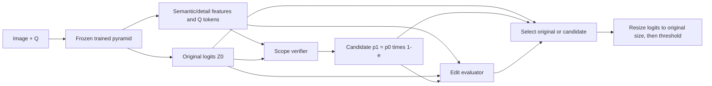

# Question-guided scope correction

This branch adds a **79,803-parameter** scope verifier and edit evaluator on top of a trained `exp/question-guided-detail-pyramid` checkpoint. The entire parent model (CLIP encoders, detail CNN, decoder, FiLM layers, and refiner) remains frozen and runs in a single shared forward pass. Both training and inference take only the image and question.

The scope verifier predicts a pixelwise removal probability `e`, forming a candidate mask `p1 = sigmoid(Z0) * (1 - e)` computed in numerically stable logit space without probability clamping. This operation can prune false-positive regions from the parent mask `Z0` while leaving non-predicted areas unchanged. An edit evaluator then takes detached verifier outputs alongside retained/removed region features, question features, and spatial mask descriptors to estimate the whole-mask IoU gain and the fraction of parent true-positive pixels removed. At inference, the selector outputs the candidate mask only when both predicted gain and damage thresholds pass; otherwise, it returns the exact parent logits `Z0`.



## Setup and train

Use Python 3.12+ and the repository's locked environment:

```bash
uv sync --frozen
uv run --frozen torchrun --standalone --nproc_per_node=2 preflight.py \
    --data-root /path/to/vizwiz \
    --init-parent-checkpoint /path/to/pyramid/checkpoint_epoch20.pt \
    --batch-size 4 --num-workers 0 --steps 3 --lr 0.0001

uv run --frozen torchrun --standalone --nproc_per_node=2 train.py \
    --data-root /path/to/vizwiz \
    --init-parent-checkpoint /path/to/pyramid/checkpoint_epoch20.pt \
    --output-dir outputs --num-epochs 20 --save-every 10 \
    --batch-size 4 --gradient-accumulation-steps 1 --num-workers 2 \
    --optimizer adamw --lr 0.0001 --weight-decay 0.01 \
    --lr-scheduler none --warmup-ratio 0 --seed 42
```

`--batch-size` is the **global microbatch across all ranks** (batch size 4 on 2 GPUs places 2 images on each GPU), and the effective batch size equals global batch size times `--gradient-accumulation-steps`. Because the frozen parent model runs without tracking gradients, activation memory is low; passing `--gradient-checkpointing` recomputes only the trainable scope decoder blocks. Run `preflight.py` first to verify GPU memory and AMP behavior on the target hardware.

Note that this stage trains the lightweight correction modules for 20 epochs on top of an already-trained 20-epoch parent checkpoint. Training uses only the `train` split without per-epoch validation.

## Settings

| Option | Default / purpose |
|---|---|
| `--init-parent-checkpoint` | Required for a new run; strict pyramid initialization |
| `--resume-checkpoint` | Full checkpoint of this experiment; mutually exclusive with initialization |
| `--num-epochs` | `20`; final total corrector epoch when resuming |
| `--batch-size` | `4`, global microbatch |
| `--gradient-accumulation-steps` | `1` |
| `--lr` | `0.0001` for the new heads |
| `--optimizer` | `adam` default; `adamw` also supported |
| `--weight-decay` | `0` default; biases/norm vectors excluded from decay |
| `--lr-scheduler` | `none` default; `cosine`, `linear`, `poly` |
| `--warmup-ratio`, `--min-lr-ratio`, `--poly-power` | `0`, `0.1`, `0.9` |
| `--gain-margin` | `0.01`: require predicted improvement >1 IoU percentage point |
| `--max-damage` | `0.02`: require predicted destroyed-TP fraction <2% |
| `--save-every` | `10`; periodic resumable checkpoints plus final raw weights |
| `--seed`, `--num-workers` | `42`, `2` |
| `--config` | Optional flat JSON; **JSON > explicit CLI > defaults** |

Encoder-freezing flags are accepted for CLI compatibility, but unfreezing the parent is rejected because scope correction requires a fixed parent predictor (`--backbone-lr` is a no-op). Selection thresholds (`gain_margin` and `max_damage`) are serialized inside the checkpoint and restored on resume. Select checkpoints and thresholds on the validation split only.

Example JSON config (usable with both `preflight.py` and `train.py`):

```json
{
  "optimizer": "adamw",
  "lr": 0.0001,
  "weight_decay": 0.01,
  "lr_scheduler": "none",
  "removal_weight": 1.0,
  "retention_weight": 2.0,
  "segmentation_weight": 0.5,
  "gain_weight": 1.0,
  "damage_weight": 0.2,
  "corruption_weight": 0.5,
  "corruption_probability": 0.5,
  "gain_margin": 0.01,
  "max_damage": 0.02
}
```

Removal and retention BCE losses are normalized separately per image (with empty pixel sets contributing 0.0), and candidate mask segmentation uses `BCE + 0.5 * Dice` at 768 resolution. The evaluator uses Smooth-L1 (`beta=0.05`) for IoU gain and BCE with a fractional target for true-positive damage, both computed against **native-resolution** logits and ground truth. Hard route selection is not used to gate training gradients.

During training, an auxiliary synthetic view injects over-coverage into the source mask with probability `0.5` using either a dilated ground-truth mask (radius 16 at 768 resolution) or its 1.5x bounding box envelope set to foreground logit `4.0`. The corrupted view is weighted by `0.5` and the combined view loss is normalized by `1 + corruption_weight` (set `corruption_weight=0` to disable it).

## Evaluate and diagnose

```bash
uv run --frozen eval.py --checkpoint outputs/checkpoint_epoch20.pt \
    --data-root /path/to/vizwiz --dataset val --batch-size 4 \
    --num-workers 2 --output-dir outputs/eval_val_ep20
uv run --frozen diagnose.py --predictions outputs/eval_val_ep20 \
    --data-root /path/to/vizwiz --output-dir outputs/diagnostic_ep20
uv run --frozen diagnose_scope.py --predictions outputs/eval_val_ep20 \
    --output-dir outputs/scope_diagnostic_ep20
```

A single evaluation pass computes **parent, raw candidate, and selected** mask metrics. Exported PNG masks correspond to the final selected output, while `metrics.json` records per-image native IoU and dataset-wide global IoU for the parent, candidate, and selected predictions alongside selection rates, gains, and damage. `diagnose_scope.py` breaks down paired IoU deltas by ground-truth area bucket and flags harmful edits or regressions on well-localized parent masks.

Logits are bilinearly resized to native image dimensions **before** thresholding at `0`. `mean_iou` averages per-image foreground IoU across images, while `global_iou` divides total foreground intersection pixels by total union pixels across the split (with empty-union IoU defined as `1.0`).

## Checkpoints and files

New runs strictly validate and load compatible raw or full checkpoints from `exp/question-guided-detail-pyramid`. Saved scope-correction checkpoints bundle the frozen parent weights, trainable correction heads, selection thresholds, parent checkpoint SHA256, resolved training/loss/optimizer configs, and source file hashes. Resuming restores optimizer, GradScaler, scheduler, and epoch-keyed RNG state, and requires matching seed, batch size, accumulation steps, and GPU count.

- `models/pyramid.py`: Frozen parent pyramid exposing detached multi-scale features.
- `models/scope_correction.py`: Scope verifier, edit evaluator, logit composition, and training mask corruption.
- `models/model.py`: Combined frozen-parent and scope-correction forward pass.
- `losses.py`: Removal, retention, candidate segmentation, and evaluator loss functions.
- `eval.py`, `metrics.py`, `diagnose_scope.py`: Paired native-resolution evaluation and scope diagnostics.
